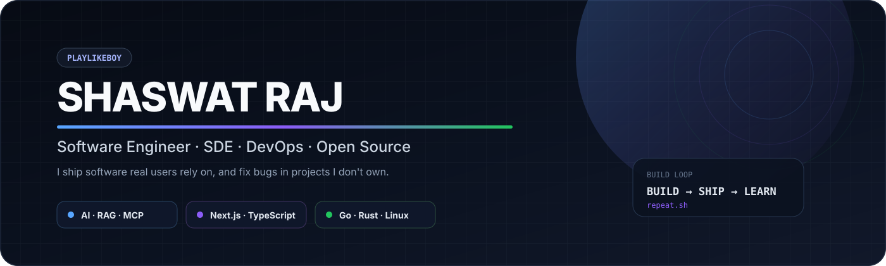

  
  
  
  
  
  
  

> **I build products that ship.**  
> AI systems, full-stack applications, developer tools, and edge-first infrastructure — from idea to production.

> 📦 **October 2026:** I consolidated all of my work from [@SH20RAJ](https://web.archive.org/web/20260906091107/https://github.com/SH20RAJ/) into this account — 330+ repositories with full commit history, every commit authored here as @playlikeboy. The complete archive also lives in the [@sh20raj-backup](https://github.com/sh20raj-backup) org and on [GitLab](https://gitlab.com/SH20RAJ).

<table>
<tr>
<td width="50%" valign="top">

### ⚡ What I'm building

**[CampusLoop](https://campusloop.space/)**  
A verified campus social platform with feeds, chat, matching, stories, communities, and campus utilities.

**AI-native developer tooling**  
RAG, agents, MCP servers, automation, search, and practical LLM workflows.

**Open-source infrastructure**  
Libraries, browser tools, CLI utilities, extensions, and systems that make developers faster.

</td>
<td width="50%" valign="top">

### 🧭 How I work

<code>discover → design → build → ship → measure → iterate</code>

I care about:
- simple architecture before clever architecture
- fast feedback and real users
- clean DX and maintainable systems
- performance at the edge
- shipping useful things, not just demos

</td>
</tr>
</table>

---

## 🚀 Selected work

| Project | What it is | Core engineering |
|---|---|---|
| **[CampusLoop](https://github.com/playlikeboy/campusloop)** | Verified campus social network with feeds, chat, matching, stories, communities and utilities | <code>Next.js</code> · <code>Cloudflare</code> · <code>PostgreSQL</code> · <code>Drizzle</code> · <code>WebRTC</code> |
| **[SopKit](https://github.com/playlikeboy/30tools)** | Privacy-first collection of browser utilities running primarily on-device | <code>Web APIs</code> · <code>WebAssembly</code> · <code>SEO</code> · <code>Performance</code> |
| **[Debo](https://github.com/playlikeboy/debo)** | AI memory and retrieval system | <code>RAG</code> · <code>Embeddings</code> · <code>Hybrid Search</code> · <code>Agents</code> |
| **[IndexFast](https://github.com/playlikeboy/index-fast)** | Automated indexing and SEO tooling with MCP integrations | <code>Next.js</code> · <code>PostgreSQL</code> · <code>Drizzle</code> · <code>MCP</code> |
| **[Sanskrit](https://github.com/playlikeboy/sanskrit)** | Experimental programming language with Devanagari syntax | <code>Lexer</code> · <code>Parser</code> · <code>Interpreter</code> · <code>CLI</code> |
| **[SopPlayer](https://github.com/playlikeboy/Sopplayer)** | Lightweight HTML5 media player distributed through a CDN | <code>JavaScript</code> · <code>Media APIs</code> · <code>Library Engineering</code> |

<strong>More things I've built</strong>

[Bitotsav '26](https://www.linkedin.com/posts/shaswatraj_bitotsav-2026-what-a-journey-what-a-responsibility-activity-7442608760193216512-Y_nn) ·
[KishanAI](https://github.com/playlikeboy/KishanAI) ·
[Solus](https://github.com/playlikeboy/solus) ·
[Linespedia](https://github.com/playlikeboy/linepedia) ·
[SnapAttend](https://github.com/playlikeboy/SnapAttend) ·
[SketchFlow](https://github.com/playlikeboy/sketchflow) ·
[CodeSeek](https://github.com/playlikeboy/CodeSeek) ·
[Picser](https://github.com/playlikeboy/picser)

---

## 🧠 Areas I enjoy

<table>
<tr>
<td><strong>AI Systems</strong> RAG · Agents · MCP · Embeddings · LLM workflows</td>
<td><strong>Product Engineering</strong> Next.js · React · TypeScript · Node.js · APIs</td>
</tr>
<tr>
<td><strong>Data & Backend</strong> PostgreSQL · MongoDB · Redis · Drizzle · Prisma</td>
<td><strong>Cloud & Edge</strong> Cloudflare Workers · Serverless · Edge Runtime · CI/CD</td>
</tr>
<tr>
<td><strong>Developer Tools</strong> npm packages · CLIs · VS Code extensions · Browser APIs</td>
<td><strong>Infra & Automation</strong> WebSockets · queues · crawling · scraping · automation</td>
</tr>
</table>

---

## 🛠️ Toolbox

<strong>TypeScript</strong> · <strong>JavaScript</strong> · <strong>Python</strong> · <strong>Rust</strong> ·
<strong>React</strong> · <strong>Next.js</strong> · <strong>Node.js</strong> ·
<strong>PostgreSQL</strong> · <strong>Cloudflare</strong> · <strong>Docker</strong>

---

## 🤝 Open source

I enjoy entering unfamiliar codebases, understanding the system, and shipping focused fixes.

**Recent contribution areas**
- **Google Gemini CLI** — environment handling, terminal propagation, PTY / child-process behavior, and tests.
- **Rocket.Chat** — React state/query fixes, accessibility, type safety, and error handling.
- **MoFA** — testing infrastructure, report exporters, timeout helpers, and reliability work.

> Good open source work is often less about the size of the diff and more about understanding the system behind it.

<!-- PRS:BEGIN -->

<strong>Upstream pull requests from @playlikeboy</strong> — 4 merged · 16 in review · 14 issues filed (updated 2026-11-11, refreshed automatically)

 

**Merged**

| Merged | Repository | Pull request | What it does |
|---|---|---|---|
| 2026-11-01 | codex-team/editor.js | [#3040](https://github.com/codex-team/editor.js/pull/3040) fix(inline-toolbar): do not show "Convert to" when there is nothing to convert to | Inline toolbar hides the "Convert to" entry when no conversion target exists. |
| 2026-10-25 | preactjs/preact | [#5331](https://github.com/preactjs/preact/pull/5331) fix(types): allow list attribute on all valid input types | Type definitions allow the list attribute on every valid input type. |
| 2026-10-22 | campusloop-space/dsaloop | [#1](https://github.com/campusloop-space/dsaloop/pull/1) feat: full online compiler, CodeMirror 6 workspace, and multi-language DSA judge engine | Online compiler, CodeMirror 6 workspace and multi-language DSA judge engine. |
| 2026-10-22 | acm-bitmesra/acm-bitmesra.github.io | [#3](https://github.com/acm-bitmesra/acm-bitmesra.github.io/pull/3) feat: student developer platform with verified identities, rankings, … | Student developer platform with verified identities and rankings. |

**In review**

| Opened | Repository | Pull request | What it does |
|---|---|---|---|
| 2026-11-10 | kmesh-net/kmesh | [#1989](https://github.com/kmesh-net/kmesh/pull/1989) fix(cni): print the previous result when CNI_ARGS cannot be loaded | kmesh-cni prints the previous CNI result instead of panicking with a nil dereference when CNI_ARGS cannot be parsed. |
| 2026-11-10 | kmesh-net/kmesh | [#1987](https://github.com/kmesh-net/kmesh/pull/1987) fix(dns): key the refresh queue by domain to avoid duplicate loops | DNS refresh queue is keyed by domain, so repeated xDS updates for one hostname no longer start duplicate refresh loops. |
| 2026-11-05 | kmesh-net/kmesh | [#1983](https://github.com/kmesh-net/kmesh/pull/1983) waypoint: compare dataplane-mode label case-insensitively like the daemon | kmeshctl waypoint compares the istio.io/dataplane-mode label case-insensitively, matching the daemon's enrollment check. |
| 2026-11-02 | codex-team/editor.js | [#3041](https://github.com/codex-team/editor.js/pull/3041) fix(sanitizer): merge sanitize rules for the same tag instead of overwriting them | Sanitizer merges rules declared for the same tag instead of overwriting them. |
| 2026-11-02 | jaegertracing/jaeger | [#10024](https://github.com/jaegertracing/jaeger/pull/10024) fix(sampling): Reject out-of-range params in file strategies | File-based remote sampling now rejects probabilistic params outside [0,1] and rate limits outside int32 at startup and on hot reload, instead of serving them to SDKs. |
| 2026-11-01 | meta/lexical | [#9705](https://github.com/meta/lexical/pull/9705) [lexical-react][lexical-playground] Feature: Draggable individual list items _(draft)_ |  |
| 2026-11-01 | kmesh-net/kmesh | [#1977](https://github.com/kmesh-net/kmesh/pull/1977) utils: decide command success by exit status, not stderr | utils.Execute decides success by exit status; stderr output alone (e.g. iptables-legacy warnings) no longer counts as failure. |
| 2026-10-31 | asyncapi/website | [#5880](https://github.com/asyncapi/website/pull/5880) fix: resolve edit links that 404 for bindings and specification pages | Fixes edit-page links that returned 404 for bindings and specification pages. |
| 2026-10-31 | asyncapi/studio | [#1397](https://github.com/asyncapi/studio/pull/1397) test(studio): add jest runner and unit tests for server-api and specification services | Adds a Jest runner and unit tests for the server-api and specification services. |
| 2026-10-25 | radix-ui/primitives | [#4252](https://github.com/radix-ui/primitives/pull/4252) fix(Select): gate hideOthers on positioned state to avoid hiding active trigger (#4250) |  |
| 2026-10-25 | radix-ui/primitives | [#4251](https://github.com/radix-ui/primitives/pull/4251) fix(DismissableLayer): tie inside pointer capture mark to event identity (#4249) |  |
| 2026-10-24 | meta/lexical | [#9458](https://github.com/meta/lexical/pull/9458) [lexical-markdown] Feature: Support ordered lists that use the ')' delimiter |  |
| 2026-10-24 | campusloop-space/opportunities | [#1](https://github.com/campusloop-space/opportunities/pull/1) Add opportunity quality ratings, filters, logos and poster fallbacks _(draft)_ |  |
| 2026-10-22 | micromark/micromark | [#255](https://github.com/micromark/micromark/pull/255) fix(core-commonmark): allow ordered list with leading zeros to interrupt paragraph |  |
| 2026-10-22 | pingdotgg/t3code | [#23775](https://github.com/pingdotgg/t3code/pull/23775) fix(server): suppress redundant keybindings change emission on unchanged revalidation |  |
| 2026-10-22 | meta/lexical | [#9447](https://github.com/meta/lexical/pull/9447) [lexical-markdown] Bug Fix: Preserve NodeState, mode and detail of text nodes with tabs on import |  |

**Issues reported upstream** (bugs found, reproduced and documented; several carry a ready fix)

| Opened | Repository | Issue | Status | Note |
|---|---|---|---|---|
| 2026-11-10 | drizzle-team/drizzle-orm | [#6667](https://github.com/drizzle-team/drizzle-orm/issues/6667) [BUG]: drizzle-kit pull with camel casing turns FIRST_NAME into firstNAME since rc.5 | open | drizzle-kit pull camel-cased FIRST_NAME as firstNAME since rc.5. Fix with tests is ready on the fork branch fix/kit-pull-camel-screaming-snake; drizzle-orm limits PR creation to collaborators, so the branch is linked from the issue. |
| 2026-11-10 | kmesh-net/kmesh | [#1991](https://github.com/kmesh-net/kmesh/issues/1991) kmeshctl secret create fails with AlreadyExists when the existing secret has no spi | open |  |
| 2026-11-10 | kmesh-net/kmesh | [#1990](https://github.com/kmesh-net/kmesh/issues/1990) mcp: get_mesh_namespaces misses namespaces labelled istio.io/dataplane-mode=kmesh (case mismatch with the daemon) | open |  |
| 2026-11-10 | kmesh-net/kmesh | [#1988](https://github.com/kmesh-net/kmesh/issues/1988) kmesh-cni: CmdAdd panics with a nil dereference when CNI_ARGS cannot be loaded | open |  |
| 2026-11-10 | jaegertracing/jaeger | [#10116](https://github.com/jaegertracing/jaeger/issues/10116) ES/OpenSearch SPM queries grouped by operation are capped at 10 operations per service | open |  |
| 2026-11-10 | jaegertracing/jaeger | [#10115](https://github.com/jaegertracing/jaeger/issues/10115) [Bug]: Elasticsearch SPM call rates are low by (lookback-1)/lookback and zero when ratePer <= step | open |  |
| 2026-11-10 | jaegertracing/jaeger | [#10114](https://github.com/jaegertracing/jaeger/issues/10114) [Bug]: Prometheus metrics reader sends the wrong rate window for ratePer values that are not a single unit | open |  |
| 2026-11-05 | kmesh-net/kmesh | [#1982](https://github.com/kmesh-net/kmesh/issues/1982) kmeshctl waypoint: dataplane-mode label compared case-sensitively, disagrees with the daemon's enrollment check | open |  |
| 2026-11-02 | jaegertracing/jaeger | [#10023](https://github.com/jaegertracing/jaeger/issues/10023) [Bug]: File sampling provider serves out-of-range probabilistic and ratelimiting params | open |  |
| 2026-11-01 | kmesh-net/kmesh | [#1980](https://github.com/kmesh-net/kmesh/issues/1980) pkg/utils: HashName maps are read by the dual-engine bpf dump while the workload processor writes them (concurrent map crash) | open |  |
| 2026-11-01 | kmesh-net/kmesh | [#1979](https://github.com/kmesh-net/kmesh/issues/1979) mcp: config_dump tool returns 404 when the optional mode argument is omitted | open |  |
| 2026-11-01 | kmesh-net/kmesh | [#1978](https://github.com/kmesh-net/kmesh/issues/1978) pkg/dns: repeated AddDomainInQueue calls for one hostname start duplicate refresh loops that never stop | open |  |
| 2026-11-01 | kmesh-net/kmesh | [#1976](https://github.com/kmesh-net/kmesh/issues/1976) pkg/utils: Execute reports failure whenever the command writes to stderr, even on exit 0 | open |  |
| 2026-10-21 | json-schema-org/website | [#2576](https://github.com/json-schema-org/website/issues/2576) 🐛 Bug: Headings with inline code or formatting produce truncated anchor IDs, breaking TOC and internal links | open |  |

<!-- PRS:END -->

---

## 📦 A few numbers

| 50+ | 5,000+ | AI × OSS |
|---|---|---|
| npm packages created | participants supported by Bitotsav '26 engineering ecosystem | the intersection I keep exploring |

---

## 📊 GitHub

<strong>Contribution activity</strong>

<picture>
  <source media="(prefers-color-scheme: dark)" srcset="https://raw.githubusercontent.com/playlikeboy/playlikeboy/output/github-snake-dark.svg">
  <source media="(prefers-color-scheme: light)" srcset="https://raw.githubusercontent.com/playlikeboy/playlikeboy/output/github-snake.svg">
  
</picture>

---

## 🌐 Elsewhere

  <a href="https://sh20raj.gitlab.io">Portfolio</a> ·
  <a href="https://github.com/playlikeboy">GitHub</a> ·
  <a href="https://gitlab.com/SH20RAJ">GitLab</a> ·
  <a href="https://www.linkedin.com/in/sh20raj/">LinkedIn</a> ·
  <a href="https://dev.to/sh20raj">Dev.to</a> ·
  <a href="https://peerlist.io/sh20raj">Peerlist</a> ·
  <a href="https://codepen.io/sh20raj">CodePen</a> ·
  <a href="https://www.youtube.com/@StackShade">YouTube</a> ·
  <a href="https://sh20raj.21st.dev/">21st.dev</a>

### Build → Ship → Learn → Repeat

Engineering is the craft of turning ideas into useful systems.

---

## 🎬 Featured backup: DrivePlyr20

**[DrivePlyr20](https://github.com/sh20raj-backup/DrivePlyr20)** — Google Drive proxy video player with multiple HTML5 player integrations. The backup repository preserves the original history and includes migration work to use the backup Sopplayer CDN distribution.
