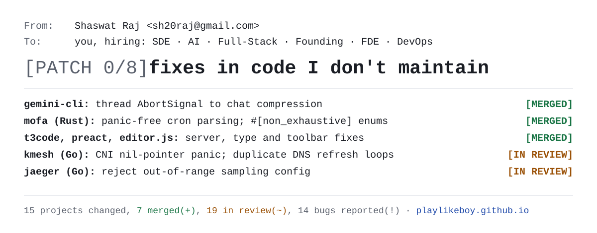

<a href="https://playlikeboy.github.io"><picture><source media="(prefers-color-scheme: dark)" srcset="https://raw.githubusercontent.com/playlikeboy/playlikeboy/main/assets/readme/hero-dark.svg"></picture></a>

# Shaswat Raj

Software engineer and founder. B.Tech CSE at BIT Mesra (graduating May 2028), Tech Lead for Bitotsav '26, and Joint Secretary of [ACM BIT Mesra](https://acm.bitmesra.ac.in/) for 2026–27. I build and run my own products alone, from schema to support inbox, and I fix bugs in open-source projects I don't maintain.

**Looking for:** internships and new-grad roles, in India or remote, at startups or large tech companies. Evidence by role, each with a tailored résumé: [SDE](https://playlikeboy.github.io/roles/sde) · [AI Engineer](https://playlikeboy.github.io/roles/ai) · [Full-Stack / Product](https://playlikeboy.github.io/roles/fullstack) · [Founding Engineer](https://playlikeboy.github.io/roles/founding) · [Forward Deployed](https://playlikeboy.github.io/roles/fde) · [DevOps / Platform](https://playlikeboy.github.io/roles/devops)
**Portfolio:** [playlikeboy.github.io](https://playlikeboy.github.io) · **Resume:** [PDF](https://playlikeboy.github.io/resume.pdf) · [my story](https://playlikeboy.github.io/story) · **Email:** [sh20raj@gmail.com](mailto:sh20raj@gmail.com) · [LinkedIn](https://www.linkedin.com/in/sh20raj/) · [Peerlist](https://peerlist.io/sh20raj)

## Products I founded and systems I led

| Project | What I did | Evidence |
|---|---|---|
| **[Bitotsav '26](https://playlikeboy.github.io/projects/bitotsav-2026)** | Tech lead for BIT Mesra's festival, ~5,000 participants. Built registration, team and points workflows, the admin panel, and signed-QR entry that keeps working in no-network zones (Redis in front of PostgreSQL). Ran it live. | [Write-up](https://www.linkedin.com/posts/sh20raj_bitotsav-2026-what-a-journey-what-a-responsibility-activity-7442608760193216512-Y_nn) |
| **[SopKit](https://sopkit.github.io)** | 605+ browser tools that process files client-side, with no uploads and no server compute. Built and run solo. 4.3M+ requests and 213K+ visits in 30 days. | [Analytics post](https://www.linkedin.com/posts/sh20raj_indiedev-seo-growthhacking-activity-7392263918737498112-Adp_) · [repo](https://github.com/SopKit/sopkit.github.io) |
| **[CampusLoop](https://campusloop.space)** | Founder. Student-only network gated by college email (accepts the domains of 1,350+ Indian colleges): feeds, marketplace, polls, time capsules. Next.js, PostgreSQL, Cloudflare Workers, WebSockets. | [repo](https://github.com/playlikeboy/campusloop) |
| **[IndexFast](https://indexfast.co)** | Founder, sole engineer. Agent-native search indexing: an MCP server, REST API and npm CLI over one core; a Workers cron submits URLs to IndexNow, Bing and Search Console. | [case study](https://playlikeboy.github.io/projects/indexfast) · [repo](https://github.com/playlikeboy/indexfast) |
| **[RUXs](https://ruxs.in)** | Founder, sole engineer. Daily tiffin and water-can subscriptions that replace a vendor's WhatsApp chats and paper ledger: household app, merchant panel, admin console. | [case study](https://playlikeboy.github.io/projects/ruxs) · [repo](https://github.com/playlikeboy/ruxs) |
| **[ScriptlyStore](https://scriptly.store)** | Founder, sole engineer. Code marketplace: Razorpay checkout priced on the server, downloads only after a verified purchase, AES-256-GCM payment links. | [case study](https://playlikeboy.github.io/projects/scriptly) · [repo](https://github.com/playlikeboy/scriptly.store) |
| **[Debo](https://debo.life)** | Founder, sole engineer. Personal AI memory: ingests notes, links and audio and answers from them in chat. | [case study](https://playlikeboy.github.io/projects/debo) · [repo](https://github.com/playlikeboy/debo.life) |

## Merged upstream

| Project | Pull request | Language |
|---|---|---|
| OneBusAway/sidecar | [#87](https://github.com/OneBusAway/sidecar/pull/87): set static gorush URL, add Android config, mark Stripe optional in Render Blueprints, and update production runbook | Go / YAML |
| OneBusAway/wayfinder | [#728](https://github.com/OneBusAway/wayfinder/pull/728): show subway and cable car icons for transit legs · [#730](https://github.com/OneBusAway/wayfinder/pull/730): show clear error states on failed searches | TypeScript / Svelte |
| WordPress/openverse | [#5850](https://github.com/WordPress/openverse/pull/5850): log the exact URL and index in dead link validation messages | Python |
| pingdotgg/t3code | [#23775](https://github.com/pingdotgg/t3code/pull/23775): suppress redundant keybindings change notifications when revalidation finds no diff (spurious toasts on Windows) | TypeScript |
| preactjs/preact | [#5331](https://github.com/preactjs/preact/pull/5331): allow the `list` attribute on every valid input type · [#5387](https://github.com/preactjs/preact/pull/5387): typed capture variants of the toggle, dialog and command event handlers | TypeScript |
| codex-team/editor.js | [#3040](https://github.com/codex-team/editor.js/pull/3040): hide "Convert to" when there is nothing to convert to · [#3048](https://github.com/codex-team/editor.js/pull/3048): isolate inline toolbar shortcuts across multiple Editor instances | TypeScript |

In review: transit backend & monitoring improvements in [OneBusAway](https://github.com/pulls?q=author%3Aplaylikeboy+org%3AOneBusAway+is%3Aopen) ([maglev#2237](https://github.com/OneBusAway/maglev/pull/2237) block sequence memoization cutting query load 58%, [watchdog#423](https://github.com/OneBusAway/watchdog/pull/423) DST trip classification fixes, [wayfinder#746](https://github.com/OneBusAway/wayfinder/pull/746), [waystation#122](https://github.com/OneBusAway/waystation/pull/122)), [Better Auth](https://github.com/better-auth/better-auth/pulls?q=author%3Aplaylikeboy) (OAuth refresh-family scoping & bounded HMAC CryptoKey LRU cache), [Openverse](https://github.com/WordPress/openverse/pull/5862), [kmesh](https://github.com/kmesh-net/kmesh/pulls?q=author%3Aplaylikeboy), [Jaeger](https://github.com/jaegertracing/jaeger/pull/10024), Lexical, Radix UI and micromark. Each fix comes with a reproduced test case or maintainer-triaged issue ([bug journal](https://playlikeboy.github.io/bugs)). Every item here is tracked live below:

<!-- PRS:BEGIN -->

<strong>Upstream pull requests from @playlikeboy</strong> — 56 merged · 46 in review (+0 draft) · 26 issues filed (updated 2026-11-28, refreshed automatically)

 

**Merged**

| Merged | Repository | Pull request | What it does |
|---|---|---|---|
| 2026-11-28 | jannskiee/floe | [#1029](https://github.com/jannskiee/floe/pull/1029) fix(desktop): ignore repeated keys on the receive action button |  |
| 2026-11-28 | Haseeb-MernStack/commune | [#298](https://github.com/Haseeb-MernStack/commune/pull/298) feat(web): add Share button to profile pages |  |
| 2026-11-28 | OneBusAway/maglev | [#2237](https://github.com/OneBusAway/maglev/pull/2237) Memoize block sort and sequence lookups | Adds memoized block trip sequence lookups and shared block shift sorting, cutting arrival-for-location SQL queries from 426 to 176. |
| 2026-11-28 | stratus-emulator/stratus | [#34](https://github.com/stratus-emulator/stratus/pull/34) s3: implement Put/Get/DeleteBucketTagging |  |
| 2026-11-27 | SopKit/games | [#7](https://github.com/SopKit/games/pull/7) fix(ratings): remove synthetic player scores and schema claims |  |
| 2026-11-27 | SopKit/games | [#2](https://github.com/SopKit/games/pull/2) fix(catalog): validate records and publish deterministic outputs atomically |  |
| 2026-11-27 | SopKit/games | [#4](https://github.com/SopKit/games/pull/4) fix(web): tolerate blocked storage and normalize catalog pagination |  |
| 2026-11-27 | SopKit/games | [#3](https://github.com/SopKit/games/pull/3) fix(images): constrain downloads and validate image payloads |  |
| 2026-11-27 | SopKit/games | [#6](https://github.com/SopKit/games/pull/6) fix(scraper): fail fast on permanent feed HTTP errors |  |
| 2026-11-27 | mohdzain98/gnost | [#35](https://github.com/mohdzain98/gnost/pull/35) docs: add troubleshooting guide for common CLI and remote errors |  |
| 2026-11-27 | SopKit/games | [#1](https://github.com/SopKit/games/pull/1) fix(scraper): validate feed data and make refresh crash-safe |  |
| 2026-11-27 | mohdzain98/gnost | [#34](https://github.com/mohdzain98/gnost/pull/34) feat(changes): report lines added and removed per changed file |  |
| 2026-11-27 | SopKit/sopkit.github.io | [#5](https://github.com/SopKit/sopkit.github.io/pull/5) Add loan EMI calculator (AdSense-ready, standalone page) |  |
| 2026-11-27 | SopKit/sopkit.github.io | [#10](https://github.com/SopKit/sopkit.github.io/pull/10) fix(image-compressor): fix object URL lifecycle, original download ext, and target warning |  |
| 2026-11-27 | SopKit/sopkit.github.io | [#9](https://github.com/SopKit/sopkit.github.io/pull/9) fix(audio): concatenate joined tracks sequentially and fix URL/AudioContext leaks |  |
| 2026-11-27 | SopKit/sopkit.github.io | [#8](https://github.com/SopKit/sopkit.github.io/pull/8) fix(seo): include all indexable category hubs in llms.txt |  |
| 2026-11-27 | SopKit/sopkit.github.io | [#7](https://github.com/SopKit/sopkit.github.io/pull/7) fix(security): harden IPv6 SSRF checks, maxResponseSizeBytes, WebP magic bytes, and path sanitization |  |
| 2026-11-27 | SopKit/sopkit.github.io | [#6](https://github.com/SopKit/sopkit.github.io/pull/6) fix(analytics): fail closed when consent is missing or storage throws |  |
| 2026-11-27 | SopKit/it-tools | [#5](https://github.com/SopKit/it-tools/pull/5) fix(wifi-qr): omit undefined PH2 and clear stale QR code on invalid input |  |
| 2026-11-27 | SopKit/it-tools | [#4](https://github.com/SopKit/it-tools/pull/4) fix(json-diff): handle removed arrays, type changes, and added nested containers |  |
| 2026-11-27 | SopKit/it-tools | [#3](https://github.com/SopKit/it-tools/pull/3) fix(c-select): fix keyboard bounds, reactive options, and ARIA semantics |  |
| 2026-11-27 | SopKit/it-tools | [#2](https://github.com/SopKit/it-tools/pull/2) fix(regex-tester): handle unmatched optional groups and mutually exclusive u/v flags |  |
| 2026-11-27 | SopKit/it-tools | [#1](https://github.com/SopKit/it-tools/pull/1) fix(base64): use mime-types lookup, fallback extension, and raw image preview |  |
| 2026-11-27 | Haseeb-MernStack/commune | [#295](https://github.com/Haseeb-MernStack/commune/pull/295) feat(web): improve empty state on Saved page with Explore CTA |  |
| 2026-11-27 | Haseeb-MernStack/commune | [#294](https://github.com/Haseeb-MernStack/commune/pull/294) feat(web): show "You're all caught up" at the end of a feed |  |
| 2026-11-27 | shoka-jp/automotive-ai-skills | [#48](https://github.com/shoka-jp/automotive-ai-skills/pull/48) docs(ev-assistant): translate guide into Spanish |  |
| 2026-11-27 | shoka-jp/automotive-ai-skills | [#47](https://github.com/shoka-jp/automotive-ai-skills/pull/47) docs(vehicle-troubleshooting): translate guide into Spanish |  |
| 2026-11-27 | pacocartones/free-llm-api-hub | [#992](https://github.com/pacocartones/free-llm-api-hub/pull/992) test(changes): cover formatValue, weekSummary and weekTitle |  |
| 2026-11-27 | pacocartones/free-llm-api-hub | [#994](https://github.com/pacocartones/free-llm-api-hub/pull/994) test(long-guides): cover wording helpers and HTML prose escaping |  |
| 2026-11-27 | shoka-jp/obd2-mcp | [#90](https://github.com/shoka-jp/obd2-mcp/pull/90) feat(pids): add Mode 01 PIDs 30 (warmups_since_clear) and 31 (distance_since_clear) |  |
| 2026-11-27 | shoka-jp/obd2-mcp | [#89](https://github.com/shoka-jp/obd2-mcp/pull/89) fix(mock): reset distance_with_mil to 0 on Mode 04 clear |  |
| 2026-11-27 | shoka-jp/obd2-mcp | [#88](https://github.com/shoka-jp/obd2-mcp/pull/88) feat(mock): add partial scenario with unsupported sensors and no freeze frame |  |
| 2026-11-26 | shoka-jp/obd2-mcp | [#61](https://github.com/shoka-jp/obd2-mcp/pull/61) feat: add Mode 01 PIDs 1F (run_time) and 21 (distance_with_mil) |  |
| 2026-11-26 | codepacct/codepact-conventions | [#9](https://github.com/codepacct/codepact-conventions/pull/9) feat(cli): validate CLI arguments and cover exit codes with integration tests |  |
| 2026-11-26 | codepacct/codepact-core | [#16](https://github.com/codepacct/codepact-core/pull/16) fix(cli): deduplicate overlapping and symlinked scan paths |  |
| 2026-11-26 | codepacct/codepact-core | [#15](https://github.com/codepacct/codepact-core/pull/15) fix(report): escape Markdown table cells for unusual paths and messages |  |
| 2026-11-26 | stratus-emulator/stratus | [#32](https://github.com/stratus-emulator/stratus/pull/32) dynamodb: report ConsumedCapacity for single-item, query/scan, batch and transaction ops |  |
| 2026-11-26 | pacocartones/free-llm-api-hub | [#868](https://github.com/pacocartones/free-llm-api-hub/pull/868) feat(site): add Cite this dataset block to /api/ and /quality/ |  |
| 2026-11-26 | stratus-emulator/stratus | [#23](https://github.com/stratus-emulator/stratus/pull/23) dynamodb: reject reserved words in expressions |  |
| 2026-11-26 | mohdzain98/surfmind | [#25](https://github.com/mohdzain98/surfmind/pull/25) test: add regression tests for search notices and timing |  |
| 2026-11-26 | Haseeb-MernStack/commune | [#288](https://github.com/Haseeb-MernStack/commune/pull/288) feat(web): show password strength while signing up |  |
| 2026-11-26 | OneBusAway/wayfinder | [#746](https://github.com/OneBusAway/wayfinder/pull/746) feat(trip-planner): show intermediate stops for transit legs | Displays intermediate stops along transit legs in the trip planner UI using OTP GraphQL data. |
| 2026-11-26 | OneBusAway/watchdog | [#423](https://github.com/OneBusAway/watchdog/pull/423) fix(gtfs): resolve DST candidate gaps, LookupTrip availability, and compile cleanups (#306) | Fixes midnight and spring-forward DST candidate date handling in ClassifyTrip, adds ScheduleAvailable/Stale status to LookupTrip, and disables trip-index retention without Postgres. |
| 2026-11-26 | traceopt-ai/traceml | [#688](https://github.com/traceopt-ai/traceml/pull/688) fix(display): hide Step memory NO_GPU row in model diagnostics |  |
| 2026-11-26 | shoka-jp/obd2-mcp | [#43](https://github.com/shoka-jp/obd2-mcp/pull/43) feat: add evap small-leak mock scenario |  |
| 2026-11-26 | shoka-jp/obd2-mcp | [#42](https://github.com/shoka-jp/obd2-mcp/pull/42) test: add unit tests for Mode 01 PID parse and encode formulas |  |
| 2026-11-26 | WordPress/openverse | [#5862](https://github.com/WordPress/openverse/pull/5862) Serve Redoc and Swagger UI via drf-spectacular-sidecar | Serves Redoc and Swagger UI static assets locally via drf-spectacular-sidecar instead of @latest CDN scripts. |
| 2026-11-26 | OneBusAway/sidecar | [#87](https://github.com/OneBusAway/sidecar/pull/87) fix(render): set static gorush URL, add Android config, mark Stripe optional | Sets static gorush URL, adds Android push config, marks Stripe optional in Render Blueprints, and updates the production runbook. |
| 2026-11-26 | WordPress/openverse | [#5850](https://github.com/WordPress/openverse/pull/5850) Log the right URL and the index in dead link validation messages | Fixes dead link validation messages to log the exact URL and index. |
| 2026-11-24 | codex-team/editor.js | [#3048](https://github.com/codex-team/editor.js/pull/3048) fix(inline-toolbar): make tool shortcuts work with several Editors on a page | Makes inline toolbar tool shortcuts work independently across multiple Editor instances on one page. |
| 2026-11-23 | OneBusAway/wayfinder | [#730](https://github.com/OneBusAway/wayfinder/pull/730) fix(search): tell the user when a search fails | Displays clear error feedback instead of silently swallowing failed search requests. |
| 2026-11-23 | OneBusAway/wayfinder | [#728](https://github.com/OneBusAway/wayfinder/pull/728) fix(trip-planner): show an icon for subway and cable car legs | Renders subway and cable-car icons on transit legs in the trip planner. |
| 2026-11-19 | preactjs/preact | [#5387](https://github.com/preactjs/preact/pull/5387) fix(types): add capture variants of toggle, dialog and command events | Adds typed capture variants for toggle, dialog, and command event handlers. |
| 2026-11-14 | pingdotgg/t3code | [#23775](https://github.com/pingdotgg/t3code/pull/23775) fix(server): suppress redundant keybindings change emission on unchanged revalidation | Suppresses redundant keybindings change notifications when revalidation detects no diff. |
| 2026-11-01 | codex-team/editor.js | [#3040](https://github.com/codex-team/editor.js/pull/3040) fix(inline-toolbar): do not show "Convert to" when there is nothing to convert to | Inline toolbar hides the "Convert to" entry when no conversion target exists. |
| 2026-10-25 | preactjs/preact | [#5331](https://github.com/preactjs/preact/pull/5331) fix(types): allow list attribute on all valid input types | Type definitions allow the list attribute on every valid input type. |

**In review**

| Opened | Repository | Pull request | What it does |
|---|---|---|---|
| 2026-11-28 | stratus-emulator/stratus | [#37](https://github.com/stratus-emulator/stratus/pull/37) feat(sqs): implement message move tasks (StartMessageMoveTask, ListMessageMoveTasks, CancelMessageMoveTask) |  |
| 2026-11-28 | pacocartones/free-llm-api-hub | [#1095](https://github.com/pacocartones/free-llm-api-hub/pull/1095) feat(links): validate heading anchors in check-links |  |
| 2026-11-28 | quanta-js/quanta | [#224](https://github.com/quanta-js/quanta/pull/224) test(core,react): cover useWatch errors and deep Map/Set/cycle watching |  |
| 2026-11-28 | codepacct/codepact-core | [#29](https://github.com/codepacct/codepact-core/pull/29) feat(report): emit GitHub Actions annotations for findings |  |
| 2026-11-27 | OneBusAway/python-sdk | [#361](https://github.com/OneBusAway/python-sdk/pull/361) docs: clarify generated code and preferred contribution areas in CONTRIBUTING.md |  |
| 2026-11-27 | OneBusAway/sdk-config | [#36](https://github.com/OneBusAway/sdk-config/pull/36) feat(openapi): remove /api/where/block/{blockID}.json endpoint |  |
| 2026-11-27 | codepacct/codepact-action | [#17](https://github.com/codepacct/codepact-action/pull/17) test(action): add end-to-end tests for GitHub outputs, step summary, and strict modes |  |
| 2026-11-27 | codepacct/codepact-conventions | [#11](https://github.com/codepacct/codepact-conventions/pull/11) test(examples): add documented examples and schema/validator integration tests |  |
| 2026-11-27 | codepacct/codepact-core | [#26](https://github.com/codepacct/codepact-core/pull/26) test(packaging): verify tracked files survive npm pack |  |
| 2026-11-27 | codepacct/codepact-action | [#16](https://github.com/codepacct/codepact-action/pull/16) ci: add windows-latest to unit-test matrix |  |
| 2026-11-27 | codepacct/codepact-conventions | [#10](https://github.com/codepacct/codepact-conventions/pull/10) feat(cli): add structured --json output to validate-config |  |
| 2026-11-27 | codepacct/codepact-core | [#25](https://github.com/codepacct/codepact-core/pull/25) test(cli): add end-to-end CLI output and exit-code regression tests |  |
| 2026-11-27 | stratus-emulator/stratus | [#36](https://github.com/stratus-emulator/stratus/pull/36) s3: implement Put/Get/DeleteObjectTagging |  |
| 2026-11-27 | OneBusAway/wayfinder | [#755](https://github.com/OneBusAway/wayfinder/pull/755) fix(search): skip upstream calls when search query is blank |  |
| 2026-11-27 | stratus-emulator/stratus | [#35](https://github.com/stratus-emulator/stratus/pull/35) kinesis: implement StartStreamEncryption and StopStreamEncryption |  |
| 2026-11-27 | OneBusAway/wayfinder | [#754](https://github.com/OneBusAway/wayfinder/pull/754) fix(otp): enforce strict numeric HH:mm format in validateTimeInput |  |
| 2026-11-26 | OneBusAway/wayfinder | [#753](https://github.com/OneBusAway/wayfinder/pull/753) fix(surveys): omit blank userId params and guard non-array survey payloads |  |
| 2026-11-26 | OneBusAway/wayfinder | [#751](https://github.com/OneBusAway/wayfinder/pull/751) fix(alerts): check upstream HTTP status and validate multi-period GTFS-RT alerts |  |
| 2026-11-26 | OneBusAway/wayfinder | [#750](https://github.com/OneBusAway/wayfinder/pull/750) fix(service-alerts): clamp stale page state and label pagination controls |  |
| 2026-11-26 | OneBusAway/wayfinder | [#749](https://github.com/OneBusAway/wayfinder/pull/749) fix(routes): show error and retry action when route list fails to load |  |
| 2026-11-26 | OneBusAway/wayfinder | [#748](https://github.com/OneBusAway/wayfinder/pull/748) fix(geocoder): guard queryPrediction entries, missing Bing addresses, and HTTP errors |  |
| 2026-11-26 | OneBusAway/wayfinder | [#747](https://github.com/OneBusAway/wayfinder/pull/747) fix(alerts): sanitize alert link URLs and react to locale updates |  |
| 2026-11-26 | yairbarak22/TutorAI | [#24](https://github.com/yairbarak22/TutorAI/pull/24) fix(llm): friendly error message and demo fallback on API budget limit |  |
| 2026-11-26 | devkitshq/notifkit | [#65](https://github.com/devkitshq/notifkit/pull/65) feat(provider-teams): add Microsoft Teams channel and Workflows provider |  |
| 2026-11-26 | quanta-js/quanta | [#223](https://github.com/quanta-js/quanta/pull/223) test(core): raise create-store branch coverage |  |
| 2026-11-26 | Blivius/renpet | [#10](https://github.com/Blivius/renpet/pull/10) fix(records): only warn about Claude Code cleanup when cleanupPeriodDays < 90 |  |
| 2026-11-26 | better-auth/better-auth | [#12993](https://github.com/better-auth/better-auth/pull/12993) perf: cache HMAC CryptoKey across signing and verification | Adds a bounded per-SubtleCrypto LRU cache for imported HMAC keys across cookie, bearer, and two-factor verification. |
| 2026-11-26 | better-auth/better-auth | [#12992](https://github.com/better-auth/better-auth/pull/12992) fix(oauth-provider): scope refresh family invalidation to authorization grant | Scopes OAuth refresh token family invalidation to the authorization code grant rather than revoking unrelated user grants. |
| 2026-11-26 | OneBusAway/sdk-config | [#35](https://github.com/OneBusAway/sdk-config/pull/35) fix(openapi): default trips-for-route includeStatus/includeSchedule to true | Defaults includeStatus and includeSchedule query parameters to true in trips-for-route OpenAPI spec. |
| 2026-11-26 | OneBusAway/waystation | [#122](https://github.com/OneBusAway/waystation/pull/122) test(board): add Playwright 1920x1080 single-board layout check | Adds a Playwright 1920x1080 single-board layout regression check and shares compact layout threshold logic. |
| 2026-11-13 | codex-team/editor.js | [#3049](https://github.com/codex-team/editor.js/pull/3049) fix(conversion): keep inline formatting when converting to a Tool with per-field sanitize rules |  |
| 2026-11-12 | traceroot-ai/traceroot | [#3013](https://github.com/traceroot-ai/traceroot/pull/3013) fix(worker): keep OTLP bytesValue attributes instead of dropping them |  |
| 2026-11-10 | kmesh-net/kmesh | [#1989](https://github.com/kmesh-net/kmesh/pull/1989) fix(cni): print the previous result when CNI_ARGS cannot be loaded | kmesh-cni prints the previous CNI result instead of panicking with a nil dereference when CNI_ARGS cannot be parsed. |
| 2026-11-10 | kmesh-net/kmesh | [#1987](https://github.com/kmesh-net/kmesh/pull/1987) fix(dns): key the refresh queue by domain to avoid duplicate loops | DNS refresh queue is keyed by domain, so repeated xDS updates for one hostname no longer start duplicate refresh loops. |
| 2026-11-05 | kmesh-net/kmesh | [#1983](https://github.com/kmesh-net/kmesh/pull/1983) waypoint: compare dataplane-mode label case-insensitively like the daemon | kmeshctl waypoint compares the istio.io/dataplane-mode label case-insensitively, matching the daemon's enrollment check. |
| 2026-11-02 | codex-team/editor.js | [#3041](https://github.com/codex-team/editor.js/pull/3041) fix(sanitizer): merge sanitize rules for the same tag instead of overwriting them | Sanitizer merges rules declared for the same tag instead of overwriting them. |
| 2026-11-02 | jaegertracing/jaeger | [#10024](https://github.com/jaegertracing/jaeger/pull/10024) fix(sampling): Reject out-of-range params in file strategies | File-based remote sampling now rejects probabilistic params outside [0,1] and rate limits outside int32 at startup and on hot reload, instead of serving them to SDKs. |
| 2026-11-01 | meta/lexical | [#9705](https://github.com/meta/lexical/pull/9705) [lexical-react][lexical-playground] Feature: Draggable individual list items |  |
| 2026-11-01 | kmesh-net/kmesh | [#1977](https://github.com/kmesh-net/kmesh/pull/1977) utils: decide command success by exit status, not stderr | utils.Execute decides success by exit status; stderr output alone (e.g. iptables-legacy warnings) no longer counts as failure. |
| 2026-10-31 | asyncapi/website | [#5880](https://github.com/asyncapi/website/pull/5880) fix: resolve edit links that 404 for bindings and specification pages | Fixes edit-page links that returned 404 for bindings and specification pages. |
| 2026-10-31 | asyncapi/studio | [#1397](https://github.com/asyncapi/studio/pull/1397) test(studio): add jest runner and unit tests for server-api and specification services | Adds a Jest runner and unit tests for the server-api and specification services. |
| 2026-10-25 | radix-ui/primitives | [#4252](https://github.com/radix-ui/primitives/pull/4252) fix(Select): gate hideOthers on positioned state to avoid hiding active trigger (#4250) |  |
| 2026-10-25 | radix-ui/primitives | [#4251](https://github.com/radix-ui/primitives/pull/4251) fix(DismissableLayer): tie inside pointer capture mark to event identity (#4249) |  |
| 2026-10-24 | meta/lexical | [#9458](https://github.com/meta/lexical/pull/9458) [lexical-markdown] Feature: Support ordered lists that use the ')' delimiter |  |
| 2026-10-22 | micromark/micromark | [#255](https://github.com/micromark/micromark/pull/255) fix(core-commonmark): allow ordered list with leading zeros to interrupt paragraph |  |
| 2026-10-22 | meta/lexical | [#9447](https://github.com/meta/lexical/pull/9447) [lexical-markdown] Bug Fix: Preserve NodeState, mode and detail of text nodes with tabs on import |  |

**Issues reported upstream** (bugs found, reproduced and documented; several carry a ready fix)

| Opened | Repository | Issue | Status | Note |
|---|---|---|---|---|
| 2026-11-27 | OneBusAway/wayfinder | [#765](https://github.com/OneBusAway/wayfinder/issues/765) bug(search): GET /api/oba/search queries upstream OBA and geocoder when query is blank | open |  |
| 2026-11-27 | OneBusAway/wayfinder | [#764](https://github.com/OneBusAway/wayfinder/issues/764) bug(otp): validateTimeInput accepts malformed times like '12abc:00' or '+09:30' | open |  |
| 2026-11-27 | OneBusAway/wayfinder | [#763](https://github.com/OneBusAway/wayfinder/issues/763) bug(surveys): blank userId forwarded as ?userId=null and non-array survey payloads throw TypeError | open |  |
| 2026-11-27 | OneBusAway/wayfinder | [#762](https://github.com/OneBusAway/wayfinder/issues/762) bug(alerts): /api/oba/alerts crashes on non-OK upstream responses and misses active multi-period GTFS-RT alerts | open |  |
| 2026-11-27 | OneBusAway/wayfinder | [#761](https://github.com/OneBusAway/wayfinder/issues/761) bug(service-alerts): stale pagination page left blank when alerts shrink or stop changes | open |  |
| 2026-11-27 | OneBusAway/wayfinder | [#760](https://github.com/OneBusAway/wayfinder/issues/760) bug(routes): ViewAllRoutesModal shows an empty blank list when /api/oba/routes fails | open |  |
| 2026-11-27 | OneBusAway/wayfinder | [#759](https://github.com/OneBusAway/wayfinder/issues/759) bug(geocoder): uncaught failures on queryPrediction entries, missing Bing addresses, and non-OK upstream responses | open |  |
| 2026-11-27 | OneBusAway/wayfinder | [#758](https://github.com/OneBusAway/wayfinder/issues/758) bug(alerts): unsafe alert URLs rendered directly and locale changes ignored in AlertsModal | open |  |
| 2026-11-19 | OneBusAway/wayfinder | [#729](https://github.com/OneBusAway/wayfinder/issues/729) Trip planner: show the stops a transit leg passes | closed |  |
| 2026-11-12 | mcp-use/mcp-use | [#3083](https://github.com/mcp-use/mcp-use/issues/3083) docs/examples: add a Cloudflare Workers deployment example + v2 docs page for the TypeScript server | open |  |
| 2026-11-12 | traceroot-ai/traceroot | [#3012](https://github.com/traceroot-ai/traceroot/issues/3012) bug(worker): OTLP bytes_value attributes are dropped at ingest (extract_attribute_value has no bytesValue branch) | open |  |
| 2026-11-11 | kmesh-net/kmesh | [#1992](https://github.com/kmesh-net/kmesh/issues/1992) CI: unit-test job runs ./pkg/... only, so ctl/ tests never execute | open |  |
| 2026-11-10 | drizzle-team/drizzle-orm | [#6667](https://github.com/drizzle-team/drizzle-orm/issues/6667) [BUG]: drizzle-kit pull with camel casing turns FIRST_NAME into firstNAME since rc.5 | open | drizzle-kit pull camel-cased FIRST_NAME as firstNAME since rc.5. Fix with tests is ready on the fork branch fix/kit-pull-camel-screaming-snake; drizzle-orm limits PR creation to collaborators, so the branch is linked from the issue. |
| 2026-11-10 | kmesh-net/kmesh | [#1991](https://github.com/kmesh-net/kmesh/issues/1991) kmeshctl secret create fails with AlreadyExists when the existing secret has no spi | open |  |
| 2026-11-10 | kmesh-net/kmesh | [#1990](https://github.com/kmesh-net/kmesh/issues/1990) mcp: get_mesh_namespaces misses namespaces labelled istio.io/dataplane-mode=kmesh (case mismatch with the daemon) | closed |  |
| 2026-11-10 | kmesh-net/kmesh | [#1988](https://github.com/kmesh-net/kmesh/issues/1988) kmesh-cni: CmdAdd panics with a nil dereference when CNI_ARGS cannot be loaded | open |  |
| 2026-11-10 | jaegertracing/jaeger | [#10116](https://github.com/jaegertracing/jaeger/issues/10116) ES/OpenSearch SPM queries grouped by operation are capped at 10 operations per service | open |  |
| 2026-11-10 | jaegertracing/jaeger | [#10115](https://github.com/jaegertracing/jaeger/issues/10115) [Bug]: Elasticsearch SPM call rates are low by (lookback-1)/lookback and zero when ratePer <= step | closed |  |
| 2026-11-10 | jaegertracing/jaeger | [#10114](https://github.com/jaegertracing/jaeger/issues/10114) [Bug]: Prometheus metrics reader sends the wrong rate window for ratePer values that are not a single unit | open |  |
| 2026-11-05 | kmesh-net/kmesh | [#1982](https://github.com/kmesh-net/kmesh/issues/1982) kmeshctl waypoint: dataplane-mode label compared case-sensitively, disagrees with the daemon's enrollment check | open |  |
| 2026-11-02 | jaegertracing/jaeger | [#10023](https://github.com/jaegertracing/jaeger/issues/10023) [Bug]: File sampling provider serves out-of-range probabilistic and ratelimiting params | open |  |
| 2026-11-01 | kmesh-net/kmesh | [#1980](https://github.com/kmesh-net/kmesh/issues/1980) pkg/utils: HashName maps are read by the dual-engine bpf dump while the workload processor writes them (concurrent map crash) | closed |  |
| 2026-11-01 | kmesh-net/kmesh | [#1979](https://github.com/kmesh-net/kmesh/issues/1979) mcp: config_dump tool returns 404 when the optional mode argument is omitted | closed |  |
| 2026-11-01 | kmesh-net/kmesh | [#1978](https://github.com/kmesh-net/kmesh/issues/1978) pkg/dns: repeated AddDomainInQueue calls for one hostname start duplicate refresh loops that never stop | open |  |
| 2026-11-01 | kmesh-net/kmesh | [#1976](https://github.com/kmesh-net/kmesh/issues/1976) pkg/utils: Execute reports failure whenever the command writes to stderr, even on exit 0 | open |  |
| 2026-10-21 | json-schema-org/website | [#2576](https://github.com/json-schema-org/website/issues/2576) 🐛 Bug: Headings with inline code or formatting produce truncated anchor IDs, breaking TOC and internal links | closed |  |

<!-- PRS:END -->

## Writing

- [Ctrl+C in gemini-cli didn't cancel chat compression](https://playlikeboy.github.io/blog/cancelling-a-turn-in-gemini-cli)
- [A nil pointer in Kmesh's CNI plugin, and the fallback that never ran](https://playlikeboy.github.io/blog/kmesh-cni-nil-crash)
- [Designing IndexFast's MCP server for agents, not people](https://playlikeboy.github.io/blog/an-mcp-server-agents-can-use)

## Stack

**Languages:** TypeScript, JavaScript, Go, Rust (contributions), Python, C++, SQL, Bash
**Frontend:** React, Next.js, Tailwind CSS, WebAssembly
**Backend & data:** Node.js, Hono, Express, FastAPI, PostgreSQL, Redis, Drizzle, WebSockets
**Infra:** Docker, GitHub Actions, GitLab CI, Cloudflare Workers, Linux
**AI:** OpenAI / Claude / Gemini APIs, RAG, vector search, Model Context Protocol

Elsewhere: [Dev.to](https://dev.to/sh20raj) (45k+ Followers) · [YouTube (StackShade)](https://www.youtube.com/@StackShade) · [Codeforces](https://codeforces.com/profile/playlikeboy) · [Codolio](https://codolio.com/profile/sh20raj)
